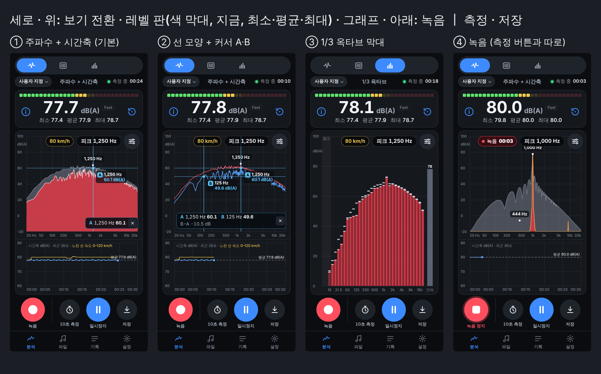
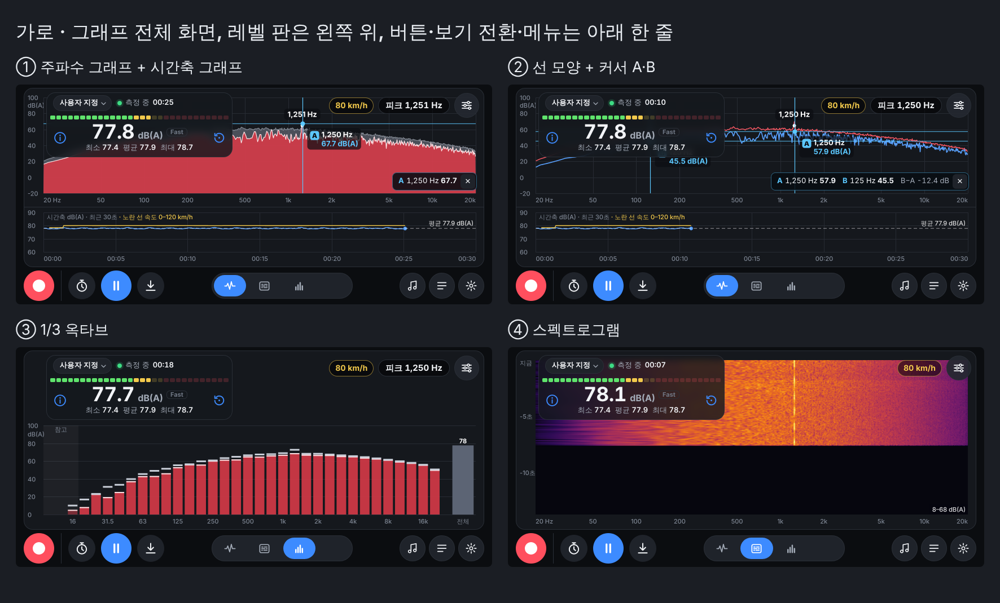
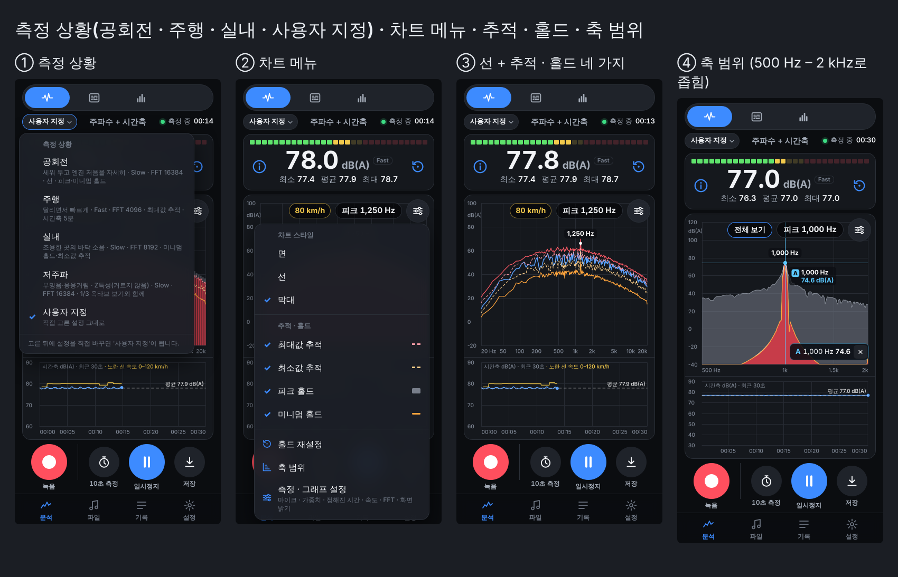
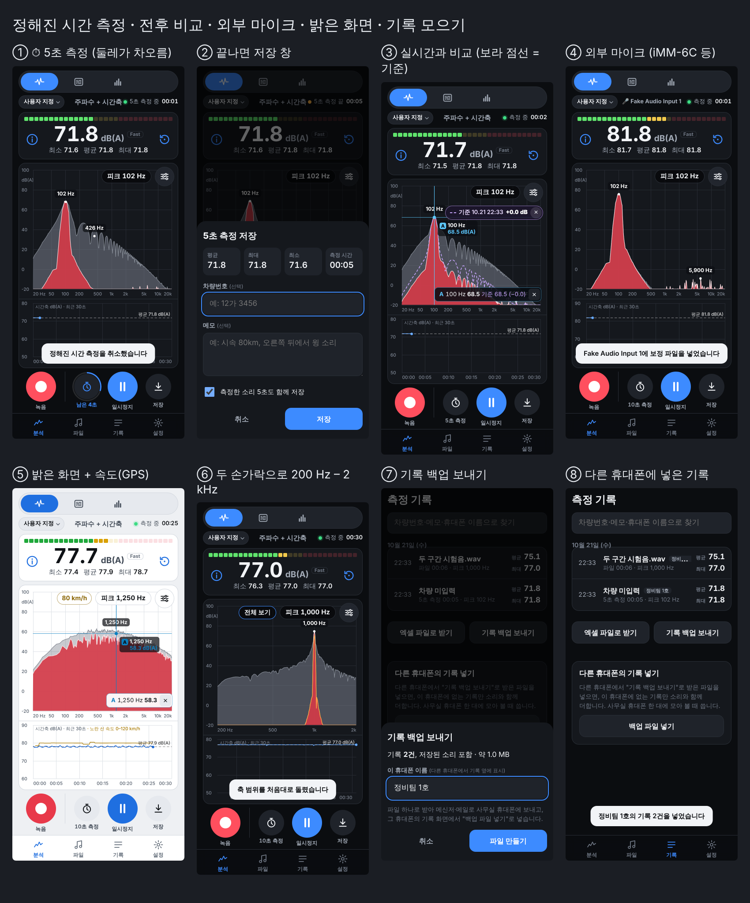
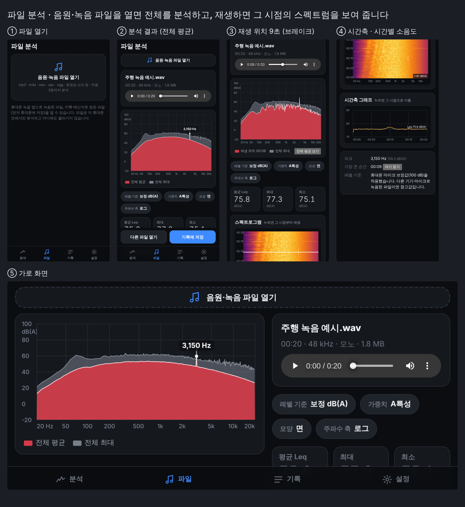

# 실시간 소음 분석 (현장용 웹앱)

휴대폰 마이크로 소음을 **실시간 분석**하는 웹앱(PWA)입니다. 설치 없이 링크로 열고, "홈 화면에 추가"하면 앱처럼 쓸 수 있습니다. 안드로이드(크롬)와 아이폰(사파리) 모두 됩니다.











## 화면

**실시간 분석 (기본 화면)**

- **맨 위 보기 전환**(아이콘, 아래에 이름): **주파수 + 시간축**(기본) / 스펙트로그램 / 1/3 옥타브
- **측정 상황**(보기 전환 아래 왼쪽 "사용자 지정 ⌄" 버튼): 상황을 고르면 여러 설정이 한 번에 바뀝니다.
  - **공회전**: 세워 두고 엔진 저음을 자세히 — A특성, Slow, FFT 16384, 선, 피크·미니멈 홀드, 시간축 1분
  - **주행**: 달리면서 빠르게 — A특성, Fast, FFT 4096, 면, 피크 홀드 + 최대값 추적, 시간축 5분
  - **실내**: 조용한 곳의 바닥 소음 — A특성, Slow, FFT 8192, 선, 피크·미니멈 홀드 + 최소값 추적, 시간축 1분
  - **저주파**: 부밍음·웅웅거림 — Z특성(거르지 않음), Slow, FFT 16384, 선, 피크·미니멈 홀드 (1/3 옥타브 보기와 함께)
  - **사용자 지정**: 직접 고른 설정. 상황을 고른 뒤 설정을 직접 바꾸면 사용자 지정이 되고, 사용자 지정을 다시 고르면 직접 맞춰 둔 설정으로 돌아옵니다. (보기·보정값·축 범위는 바뀌지 않습니다.)
- **레벨 판**: 색 막대(초록 → 노랑 → 빨강, 빨강은 경고 기준 이상, 밝은 칸 하나는 최대), 큰 숫자로 **지금 소음**(옆에 Fast / Slow), 그 아래 **최소 · 평균 · 최대**.
  왼쪽 ⓘ 는 화면 보는 법, 오른쪽 ↻ 는 초기화(최소·평균·최대·홀드·녹음 버퍼 다시 시작)
- **기본 화면은 그래프 두 개**: 위에 큰 **주파수 그래프**(주파수–dB), 아래에 작은 **시간축 그래프**(시간–dB, 그래프 칸의 약 1/3)
- **주파수 그래프 (FFT 스펙트럼)**: 가로축 **20 Hz – 20 kHz**(로그) 또는 0 – 20 kHz(선형), 세로축 **주파수 가중치를 적용한 dB**(기본 dB(A))
  - 모양 **면**: 빨강 = 지금, 회색 = 피크 홀드 / **선**: 파랑 = 지금, 빨강 = 피크 홀드 / **막대**
  - 어느 모양이든 주황 선 = 미니멈 홀드, 분홍 점선 = 최대값 추적, 연주황 점선 = 최소값 추적, 보라 점선 = 비교 기준(아래 "전후 비교")
  - 뚜렷하게 튀는 주파수 2개에 "1,250 Hz"처럼 표시하고, 오른쪽 위에 가장 큰 피크를 보여 줍니다.
  - **두 손가락으로 벌리거나 좁히면** 주파수 범위가 바뀝니다(손가락 아래 주파수가 그대로 따라옴). "전체 보기"를 누르면 20 Hz – 20 kHz로 돌아갑니다.
- **십자선 커서**: 그래프를 누르면 세로·가로 선이 곡선과 만나는 점에 "A 1,241 Hz / 56.5 dB(A)"를 띄웁니다. 한 번 더 누르면 커서 B, 아래 줄에 두 값과 차이(B−A). 끌어서 옮기고 × 로 지웁니다.
- **스펙트로그램**(따로 선택하는 보기): 같은 주파수 축에서 시간에 따른 변화를 색으로 보여 줍니다. 맨 위가 지금입니다. 다른 보기를 보는 동안에도 최근 1분을 기억해서, 열면 바로 지난 소리가 보이고 화면을 돌려도 남아 있습니다.
- **1/3 옥타브**: **10 Hz – 20 kHz** 34개 대역 막대(20 Hz 아래는 "참고" 구역으로 흐리게), 대역별 최대(·최소) 표시, 맨 오른쪽에 **전체** 막대
- **시간축 그래프**: 가로 측정 시간, 세로 소음 크기(큰 숫자와 같은 값, 0.05초마다). 최근 30초 · 1분 · 5분이 흘러가고, 점선은 평균입니다. 속도(GPS)를 켜면 노란 선으로 속도가 함께 그려집니다.
- **차트 메뉴(그래프 오른쪽 위 버튼)**: 바로 아래에 메뉴가 열립니다(바깥을 누르면 닫힘).
  - **차트 스타일**: 면 / 선 / 막대
  - **최대값 추적 · 최소값 추적**: 최근 큰·작은 값을 따라가다 초당 12 dB씩 돌아오는 점선
  - **피크 홀드 · 미니멈 홀드**: 초기화 뒤 가장 큰 · 가장 작은 값
  - **홀드 재설정**: 위 선들만 새로 시작
  - **축 범위**: 가로 주파수(전체 · 저주파 10–200 Hz · 저음 · 중음 · 고음 또는 직접 입력), 그래프마다 세로 dB(자동 / 직접), 스펙트로그램 색 범위. "처음대로"로 되돌립니다.
  - **측정 · 그래프 설정**:
    - 측정: **마이크**(휴대폰 기본 / 꽂은 외부 마이크), **주파수 가중치 A / C / Z**, **시간 가중 Fast(0.125초) / Slow(1초)**, **정해진 시간 측정** 길이(5초 / 10초 / 30초 / 1분), **속도 (GPS)** 끔 / 켬
    - 그래프: 시간축 그래프 길이(30초 / 1분 / 5분), FFT 크기(2048 – 16384), 주파수 축(로그 / 선형), **화면 밝기**(어둡게 / 밝게 — 햇빛 아래에서 읽기 쉬운 밝은 화면)
- 세로: 위에서부터 보기 전환, 레벨 판, 그래프(남는 높이 전부), 버튼. 가로: 그래프가 화면 가득, 레벨 판은 그래프 왼쪽 위에, 버튼·보기 전환·메뉴는 아래 한 줄

**버튼** (두 묶음): ● **녹음**(빨강) ┃ ⏱ **정해진 시간 측정** · ▶⏸ **측정 시작 / 일시정지** · ⬇ **저장**(지금 스펙트럼과 값, **방금 들린 소리**를 차량번호·메모와 함께 저장)

**녹음은 측정과 따로 움직입니다**: 누른 때부터 정지할 때까지 녹음합니다(최대 5분). 녹음 길이는 그래프 위 빨간 "● 녹음 00:12"에 따로 나옵니다.
측정을 일시정지해도 녹음은 계속되고, 녹음 버튼이 일시정지를 풀지도 않습니다. 정지하면 측정은 그대로 이어지고, 녹음은 **파일** 탭에 들어가며 알림의 **분석 보기**로 바로 분석합니다.

**정해진 시간 측정(⏱)**: 누르면 처음부터 다시 시작해 **딱 N초**(기본 10초)만 재고 저절로 멈춘 뒤 저장 창을 엽니다. 버튼 둘레가 차오르고 "남은 7초"가 줄어듭니다. 다시 누르거나 일시정지하면 취소, ↻ 초기화하면 N초를 처음부터 다시 잽니다. 저장하면 그 N초의 소리가 함께 남고, 기록에 "10초 측정"으로 표시됩니다.

**전후 비교**: 기록 화면의 **"실시간과 비교"**를 누르면 그 기록의 평균 스펙트럼이 실시간 그래프에 **보라 점선(기준)**으로 겹쳐지고, 그래프 위 "기준 …" 표시에 지금 평균과 기준 평균의 차이(+2.1 dB)가 나옵니다. 커서도 기준 값과 차이를 함께 읽습니다. 가중치가 다른 기록이면 차이 대신 알림이 나옵니다.
**"다른 기록과 비교"**는 기록끼리 겹쳐 보고 두 평균과 차이를 보여 줍니다. 수리 전에 10초 측정해 저장 → 수리 후 그 기록을 기준으로 다시 10초 측정하는 식으로 씁니다.

**속도 (GPS, 선택)**: 켜면 위치 권한을 묻고, 측정하는 동안 차 속도를 그래프 위(노란 숫자)와 시간축 그래프(노란 선)에 보여 줍니다. 저장하면 평균·최고·저장 순간 속도가 기록·요약 글·공유 이미지·엑셀에 남습니다. **위치 자체는 저장하지 않습니다.**

**파일 분석** (아래 탭 "파일"): 음원·녹음 파일(mp3, m4a, wav, aac, ogg, 동영상의 소리 등)을 열면 파일 전체를 분석합니다.

- 평균(Leq)·최대·최소, 전체 평균·최대 스펙트럼과 피크, 가장 큰 순간
- 파일 전체의 **스펙트로그램**과 **시간축 그래프**. 누르면 그 시점으로 이동해 들을 수 있고, 재생하면 스펙트럼이 재생 위치의 소리로 바뀝니다.
- 레벨 기준: **보정 dB**(이 휴대폰 마이크 보정값 적용, 녹음 파일용) / **파일 dBFS**(디지털 크기, 음원용), 가중치 A / C / Z
- **기록에 저장**하면 파일(30MB 이하)도 함께 남습니다. 처음 5분까지 분석하고, 파일은 휴대폰 안에서만 처리됩니다.

**기록**: 저장한 분석 목록(차량번호·메모·휴대폰 이름으로 찾기), 상세 화면(스펙트럼 + 커서, 측정 평균 선, 값, 소리, 비교), 결과 이미지·요약 글 공유(카톡 등), 엑셀(CSV) 내보내기

**기록 모으기 (서버 없이)**: 기록 화면의 **"기록 백업 보내기"**는 이 휴대폰 이름(예: 정비팀 1호)을 묻고, 모든 기록을 **소리까지 파일 하나(.nmb)**로 만듭니다. 메신저·메일로 사무실 휴대폰에 보내 그쪽 기록 화면의 **"백업 파일 넣기"**로 넣으면, 그 휴대폰에 없는 기록만 더해지고 기록 옆에 어느 휴대폰에서 쟀는지 표시됩니다. 같은 파일을 두 번 넣어도 겹치지 않습니다.

**설정 (관리자 비밀번호, 처음 값 `0000`)**: 회사 이름, 저장할 때 남길 소리 길이(없음/5/10/20/30초), 경고 기준(색 막대 빨강), **마이크 보정**(마이크별), 마이크 보정 파일, 비밀번호 변경, 기록 삭제

## 마이크

평소에는 **휴대폰 마이크**로 잽니다(기본값). 외부 측정 마이크는 선택입니다.

- **외부 측정 마이크**(예: Dayton Audio **iMM-6C**, USB-C): 휴대폰에 꽂으면 "새 마이크: … [이 마이크 쓰기]" 알림이 뜨고, 측정 · 그래프 설정의 "마이크"에서도 고를 수 있습니다. 쓰는 동안 화면 위에 "🎤 이름"이 보이고, 보정 전이면 "보정 안 됨"이 붙습니다. 빼면 휴대폰 마이크로 돌아갑니다.
- 마이크마다 보정값을 따로 기억합니다. 처음 꽂은 외부 마이크는 휴대폰 마이크의 보정값으로 시작하므로, 설정 → 마이크 보정에서 **"보정할 마이크"**로 그 마이크를 고르고 따로 보정하세요.
- **보정 파일**: 측정 마이크와 함께 받은 주파수 특성 파일(.txt — miniDSP UMIK, Dayton iMM-6C, REW 형식)을 넣으면 스펙트럼·1/3 옥타브의 저음·고음 오차를 바로잡습니다. iMM-6C 파일 첫 줄의 `*1000Hz -40.3`(1 kHz 감도)도 읽어 보여 줍니다. 큰 숫자(전체 dB)는 보정값으로 맞춥니다.

## 마이크 보정

휴대폰·마이크마다 감도가 달라서 **하나씩 한 번** 보정해야 값이 맞습니다.
설정 → 마이크 보정: 보정할 마이크를 고르고, 정밀 소음계와 나란히 두고 5초 측정 → 소음계 값(Leq, A특성) 입력 → 적용. 보정값은 그 휴대폰에만 저장됩니다.

## 배포 (GitHub Pages, 무료)

마이크는 https 주소에서만 켜지므로 웹에 올려야 합니다.

1. 저장소 **Settings → Pages → Build and deployment → Source** 를 **GitHub Actions** 로 바꿉니다.
2. 기본 브랜치에 코드가 올라가면 `.github/workflows/pages.yml` 이 테스트 후 자동 배포합니다.
3. 주소는 `https://<계정>.github.io/<저장소>/` 형태입니다. (주소를 아는 사람은 누구나 열 수 있습니다. 기록은 각 휴대폰 안에만 있습니다.)

앱을 고친 뒤에는 `sw.js` 의 `VERSION` 을 올려야 휴대폰에 새 버전이 들어갑니다.

## 측정 방식

- **레벨**(현재·평균·최대·최소): 마이크 신호를 **A특성 또는 C특성 디지털 필터**(IEC 61672 곡선, Z는 거르지 않음)로 거른 뒤 표본 하나하나로 계산합니다.
  현재·최대·최소는 Fast(125 ms) 또는 Slow(1 s) 시간 가중, 평균은 Leq입니다. 시작·초기화·가중치 변경 후 0.5초는 필터 안정화를 위해 버립니다.
- **정해진 시간 측정**: 0.05초 단위로 쌓는 측정 시간이 정확히 N초가 되는 순간 멈춥니다(Leq·최대·최소가 그 N초 값).
- **스펙트럼**: Web Audio AnalyserNode의 FFT(블랙만 창) 각 칸에 창 보정과 가중치, 보정값(+ 보정 파일의 주파수 특성)을 더한 칸별 dB입니다.
  모든 칸을 더하면 전체 소음도가 됩니다. 그래서 칸 하나의 값은 전체 소음도보다 낮고, FFT 크기를 키우면 칸이 좁아져 값이 더 낮아집니다.
  저장할 때는 지금 스펙트럼, 피크 홀드, 초기화 뒤의 **측정 평균 스펙트럼**(칸별 에너지 평균)을 함께 남깁니다. 전후 비교는 이 평균을 씁니다.
- **1/3 옥타브**: 같은 칸별 값을 대역(중심 1000·2^(n/3) Hz, 10 Hz – 20 kHz)마다 에너지로 더합니다. 10 Hz 대역에도 칸이 들어가도록 이 보기에서는 FFT 32768(약 1.5 Hz 간격)로 계산합니다.
- **홀드·추적**: 시작·초기화 뒤 0.5초가 지나고부터 FFT 칸마다 최대·최소를 기억하고, 추적 선은 새 값이 넘으면 바로 따라가고 아니면 초당 12 dB씩 지금 값 쪽으로 돌아옵니다.
- **피크**: 약 1초로 평균한 스펙트럼에서 주변보다 6 dB 이상 튀는 곳을 찾습니다.
- **속도**: 휴대폰이 알려 주는 속도를 쓰고, 없으면 위치 사이 거리 ÷ 시간으로 구합니다. 정확도가 50 m보다 나쁜 위치는 버리고, 위치 오차보다 작게 움직이면 서 있는 것(0 km/h)으로 봅니다.
- **녹음**: AudioWorklet이 마이크 원음을 순환 버퍼에 담아 두고, 저장할 때 16비트 WAV로 만듭니다(10초에 약 1MB). 녹음 버튼은 같은 원음을 모았다가 WAV로 만듭니다(5분에 약 29MB). 압축하지 않으므로 분석 값이 실시간 값과 같습니다.
- **파일·저장된 소리 분석**: 브라우저가 파일을 48 kHz 모노로 풀고, 실시간과 같은 가중치 필터·시간 가중으로 레벨을, 같은 규칙(블랙만 창 FFT 4096)으로 스펙트럼을 계산합니다.
- 브라우저의 에코 제거·잡음 제거·자동 음량 조절은 끄고 받습니다.

## 알아 둘 점

- **스마트폰 측정값은 참고값입니다.** 법정 측정(정밀 소음계)을 대신하지 않습니다.
- 휴대폰 마이크는 대략 30–100 dB 범위에서 쓸 만하고, 아주 큰 소리에서는 포화될 수 있습니다(저장된 기록에 경고 표시). 20 Hz 아래는 휴대폰 마이크가 잘 받지 못해 참고로만 보세요.
- 화면이 꺼지거나 다른 앱으로 바뀌면 측정이 멈추고, 돌아오면 새로 시작합니다. 측정 중에는 화면이 꺼지지 않게 합니다.
- 기록은 **그 휴대폰 브라우저 안에만** 저장됩니다. 필요하면 엑셀 파일이나 기록 백업으로 보내 두세요.

## 개발

빌드 도구·외부 라이브러리 없이 HTML/CSS/자바스크립트 모듈로 되어 있습니다.

```
index.html              화면 틀 (아래쪽 탭: 분석 / 파일 / 기록 / 설정)
css/app.css             스타일 (어두운 화면 + 밝은 화면, 세로·가로 배치)
js/app.js               화면과 이동 (실시간 분석, 파일 분석, 기록, 저장된 기록, 설정)
js/meter.js             마이크 측정 엔진 (Web Audio, 가중치 A/C/Z, Fast/Slow, 정해진 시간, 녹음)
js/level-processor.js   AudioWorklet: 가중치 필터, Leq, 시간 가중 최대·최소, 소리 버퍼·녹음
js/spectrum.js          FFT 스펙트럼 그래프 (면/선/막대, 홀드·추적·평균·비교 선, 커서, 두 손가락 확대, 화면 밝기 색)
js/spectrogram.js       스펙트로그램 (실시간 흐름 + 최근 1분 기억, 저장된 소리 + 재생 위치)
js/octave.js            1/3 옥타브 막대 그래프
js/levelbar.js          LED 색 막대
js/audio.js             WAV 만들기·읽기, 소리 파일 풀기(mp3·m4a 등)
js/analysis.js          파일 전체 분석 (레벨 이력, 평균·최대·최소 스펙트럼, 프레임별 스펙트럼, 피크)
js/timeline.js          시간축 그래프 (파일·기록용, 실시간용 + 속도 선)
js/dsp.js               신호처리 순수 함수 (A·C 필터 설계, 칸별 dB, 1/3 옥타브 대역, 피크, 리샘플링, FFT·STFT)
js/mics.js              마이크별 보정, 보정 파일 읽기·주파수 특성 보정
js/gps.js               위치 → 속도
js/backup.js            기록 백업 파일 만들기·읽기, 겹치지 않게 넣기
js/presets.js           측정 상황(공회전·주행·실내·저주파·사용자 지정) 설정 묶음
js/settings.js          설정 저장
js/store.js             기록 저장 (IndexedDB)
js/share.js             공유 이미지, 요약 글, CSV
js/format.js            표시 형식
sw.js, manifest.webmanifest, icons/   오프라인·홈 화면 설치
```

```bash
npm start                       # http://localhost:8080 (localhost 에서는 마이크 허용됨)
npm test                        # 신호처리·보정 파일·속도·백업 등 단위 테스트 (Node 22, 설치 불필요)
NODE_PATH=$(npm root -g) npm run test:e2e   # 크롬에 테스트 음을 마이크로 넣어 전체 흐름 확인 (playwright 필요)
```

E2E 테스트는 1 kHz·100 Hz 테스트 음(레벨을 아는 WAV)을 가짜 마이크로 넣고, 앱이 표시한 dB(A)·dB(C)·dB(Z)와 피크 주파수가 계산값과 맞는지 확인합니다.
그 밖에 커서, 두 그래프 배치, 세 가지 보기, 스펙트로그램이 숨겨진 동안의 소리를 기억하는지, 두 손가락 확대, 측정 상황, 축 범위, 차트 메뉴, 일시정지·초기화, 소리와 함께 저장·재생·WAV 보내기, 보정,
외부 마이크 고르기(따로 보정값 + 보정 파일 → 큰 숫자와 스펙트럼), 녹음이 측정과 따로 움직이는지, 5초 측정(정확히 5초·소리 5초), 실시간·기록 비교, 주행 속도(가짜 위치로 80 km/h),
파일 분석(Leq·최대·최소, dBFS 전환, 이동, 저장), 기록 백업 → 다른 휴대폰에 넣기(겹치지 않음)를 확인하고, 세로·가로·밝은 화면을 캡처합니다.
